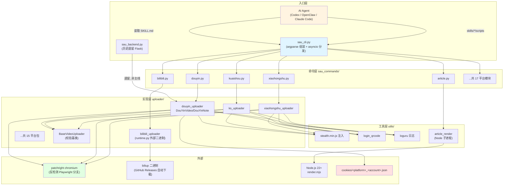
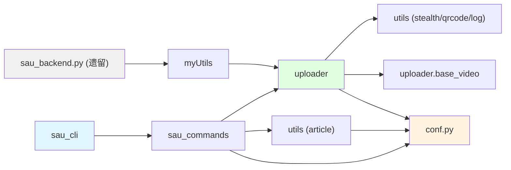

# social-auto-upload - 架构分析

> 生成时间: 2026-11-04
> 数据来源: 分析脚本输出 + 源码验证（脚本原始数据见 `out/01~05-*.md`）

## 1. 项目概览

### 1.1 项目信息

| 项目 | 内容 |
|------|------|
| 名称 | social-auto-upload |
| 语言 | Python 3.10–3.12（147 个 .py 文件）+ Vue 3 前端（13 个 JS 文件）+ Node.js 渲染器（.mjs） |
| 类型 | 多平台社交媒体自动发布工具（视频 / 文章 / 图文） |
| 描述 | 面向内容创作者和运营者的多平台发布工具，提供统一 `sau` CLI 和供 Codex、OpenClaw、Claude Code 等 Agent 使用的 Skill |
| 许可证 | 仓库主体 MIT；18 个 Agent Skill 为 MIT-0 |
| 构建工具 | setuptools（pyproject.toml）+ uv（uv.lock） |

### 1.2 支持平台（17 个平台 + 1 个总入口 Skill）

抖音、Bilibili、小红书、快手、视频号（tencent）、百家号、大鱼号、支付宝生活号、微博、虎扑、TikTok、雪球、YouTube、知乎、Facebook、Facebook Page（meta）、Instagram。

### 1.3 目录结构

```
social-auto-upload/
├── sau_cli.py              # CLI 主入口（sau = sau_cli:main）
├── sau_backend.py          # 历史遗留 Flask Web 后端（723 行，非主线）
├── conf.example.py         # 配置模板（复制为 conf.py）
├── pyproject.toml          # 包定义 + sau 入口点
├── requirements.txt        # Web 版完整依赖（注意: UTF-16 编码）
├── start-win.bat           # Windows 一键启动 Web 版脚本
├── Dockerfile              # Linux 容器构建（node builder + python 3.10）
├── sau_commands/           # ① CLI 层：每平台一个模块（register/run 约定）
├── uploader/               # ② 核心层：每平台一个浏览器自动化包
│   ├── base_video.py       #    BaseVideoUploader 校验基类
│   ├── douyin_uploader/    #    最大实现（main.py 1261 行）
│   ├── bilibili_uploader/  #    特例：封装外部 biliup 二进制（runtime.py）
│   ├── meta_uploader/      #    Facebook / Facebook Page / Instagram 共用
│   └── ...（15 个平台包）
├── utils/                  # ③ 共享工具层
│   ├── article_render.py   #    Markdown 主题渲染（调用 Node 子进程）
│   ├── article_renderer/   #    Node.js 渲染器（render.mjs + baoyu-md）
│   ├── login_qrcode.py     #    二维码保存/解码/终端显示
│   ├── base_social_media.py#    stealth.min.js 注入 + 平台常量
│   └── ...（stealth.min.js, log.py, network.py, files_times.py）
├── skills/                 # ④ Agent Skill 层：18 个 SKILL.md 分发单元
├── sau_frontend/           # ⑤ 历史遗留 Vue3+Vite+ElementPlus 前端
├── sau_backend/            #    历史遗留 Web 后端说明文档
├── myUtils/  db/           #    历史遗留 Web 辅助模块 + SQLite 建库脚本
├── examples/               #    历史直连 uploader 的调试示例
├── tests/                  #    unittest 测试（17 个文件）
└── docs/                   #    安装/更新/CLI/平台文档
```

## 2. 架构设计

### 2.1 架构模式

项目采用**分层 + 插件式平台模块**架构，主线是 CLI 驱动的三层管道：

1. **CLI 分发层**（`sau_cli.py` + `sau_commands/`）：入口只负责组装 argparse 子命令并按平台名分发，每个平台模块遵循统一约定 —— `register(platform_parsers)` 声明参数、`run(args)` 执行业务。新增平台对入口零侵入（只需在 `PLATFORMS` 字典注册）。
2. **平台实现层**（`uploader/<platform>_uploader/`）：每平台一个包，封装浏览器自动化登录（二维码/cookie）与发布流程，互不依赖。
3. **共享工具层**（`utils/`）：反检测注入、二维码处理、文章渲染、日志等横切能力。

外围有三条**辅助通道**：
- `skills/`：面向 AI Agent 的声明式文档层（SKILL.md + references + scripts），把 `sau` CLI 暴露为 Agent 可调用能力，是"文档即接口"的模式。
- `sau_backend.py` + `sau_frontend/`：历史遗留的 Flask + Vue Web 版（`docs/legacy-web.md` 明确标注**非主线、不承诺可运行**）。
- `examples/`：历史直连 uploader 的调试脚本（当前主线优先 `sau` CLI）。

**设计约定（跨平台统一）**：
- 账号会话：`cookies/{platform}_{account_name}.json`（`sau_commands/arguments.py:16`）
- 内容元数据：视频 `title + desc + tags`；图文 `title + note + tags`；文章 `title + content-file + source`
- 请求对象：CLI 层用 `@dataclass(slots=True)` 定义 Request（如 `sau_commands/douyin.py:69`），再交给 uploader 类

### 2.2 核心模块

| 模块 | 职责 | 关键文件 |
|------|------|----------|
| sau_cli | 入口、子命令组装、平台分发 | `sau_cli.py`（65 行） |
| sau_commands | 每平台参数声明 + 执行逻辑 + 账号文件解析 | `sau_commands/douyin.py`、`sau_commands/arguments.py` |
| uploader | 浏览器自动化登录与发布（patchright/Playwright） | `uploader/douyin_uploader/main.py`（1261 行） |
| uploader/base | 文件/日期校验基类 | `uploader/base_video.py`（70 行） |
| bilibili runtime | 外部 biliup 二进制的下载/更新/调用 | `uploader/bilibili_uploader/runtime.py`（191 行） |
| utils/article | HTML/Markdown/TXT 解析 + Node 主题渲染 | `utils/article_render.py`、`utils/article_content.py`、`utils/article_renderer/render.mjs` |
| utils/qrcode | 登录二维码提取、解码、终端渲染 | `utils/login_qrcode.py` |
| utils/stealth | 反自动化检测脚本注入 | `utils/stealth.min.js`、`utils/base_social_media.py:21` |
| skills | Agent Skill 分发单元（18 个） | `skills/social-auto-upload/SKILL.md` 等 |
| Web 遗留 | Flask+SSE 后端 + Vue3 前端 | `sau_backend.py`、`sau_frontend/`、`myUtils/`、`db/` |
| tests | unittest 单元/集成测试 | `tests/`（17 个文件） |

### 2.3 架构图



## 3. 依赖关系分析

### 3.1 外部依赖（pyproject.toml 主线依赖，仅 7 个）

| 依赖 | 版本 | 用途 |
|------|------|------|
| patchright | ==1.58.2 | 反检测版 Playwright（所有浏览器自动化） |
| loguru | ==0.7.3 | 结构化日志 |
| opencv-python | >=4.13.0.92 | 二维码解码（QRCodeDetector） |
| qrcode / segno | 8.2 / >=1.6.6 | 二维码生成与终端渲染 |
| requests | ==2.32.3 | biliup release 查询等 HTTP |
| tinycss2 | >=1.4.0,<2 | 文章 HTML/CSS 处理 |

可选依赖 `[project.optional-dependencies].web`：`Flask[async]==3.1.1`、`flask-cors==6.0.0`（仅历史 Web 版需要）。`requirements.txt`（81 项）是 Web 版全量锁定清单，**注意该文件是 UTF-16 编码**（见 Windows 兼容性报告 §3）。

### 3.2 模块依赖图



**关键耦合点**（grep 验证）：
- `from conf import BASE_DIR` 出现 32 次、`from conf import LOCAL_CHROME_PATH` 14 次 —— `conf.py` 是全局配置单点，缺失时所有模块无法导入
- `from patchright.async_api import async_playwright` 16 处 —— 浏览器自动化是硬依赖
- `from sau_commands.arguments import (...)` 16 处 —— CLI 层共享参数规则

### 3.3 依赖健康度

| 类别 | 数量 | 说明 |
|------|------|------|
| 主线生产依赖 | 7 | 精简，无重型 Web 框架 |
| Web 可选依赖 | 2 | Flask + flask-cors |
| Web 版锁定依赖（requirements.txt） | 81 | 含 alembic、eventlet、biliup 等历史包 |
| 运行时外部工具 | 2 | Node.js 22+（仅 Markdown 主题渲染）、biliup 二进制（Bilibili 自动下载） |

依赖分层清晰：主线 CLI 只需 7 个包；Node.js 和 biliup 都是**惰性按需**获取（`sau article setup` / 首次 bilibili 命令时下载）。

## 4. 架构亮点与风险

### 亮点

1. **平台插件约定**：`register()/run()` 双函数约定让 17 个平台的 CLI 接入完全同构（`sau_cli.py:37-50`）。
2. **三层解耦**：CLI（参数）→ Request dataclass（数据契约）→ uploader（浏览器流程），各层可独立测试。
3. **Skill 即 API**：`skills/` 把 CLI 能力包装成 Agent 可发现的分发单元，附带 `references/cli-contract.md` 等契约文档。
4. **反检测内建**：patchright + stealth.min.js 注入（`utils/base_social_media.py:21`）+ "真人级"点击序列（`uploader/douyin_uploader/main.py:50`）。

### 风险与技术债

1. **巨型单文件**：`uploader/douyin_uploader/main.py` 1261 行，登录、校验、视频、图文全部内联；相比之下 dayu/xueqiu/zhihu 已拆分为 `main.py + article.py + publication.py` 等多文件，douyin 是最需要重构的模块。
2. **遗留双轨**：Web 版（sau_backend/sau_frontend/myUtils/db）与主线并存，README 已声明非主线但仍随仓库分发；`myUtils/postVideo.py` 仍被 Web 层引用旧版 uploader 接口。
3. **配置导入即生效**：`conf.py` 必须手工从 `conf.example.py` 复制，缺失时 32 处导入全部失败，错误信息对新用户不友好。
4. **依赖 DOM 选择器**：所有 uploader 依赖平台前端 DOM（选择器兜底列表见 `uploader/douyin_uploader/main.py:163`），平台改版即失效——这是此类工具的固有风险，项目用多 selector 兜底 + 重试缓解。
