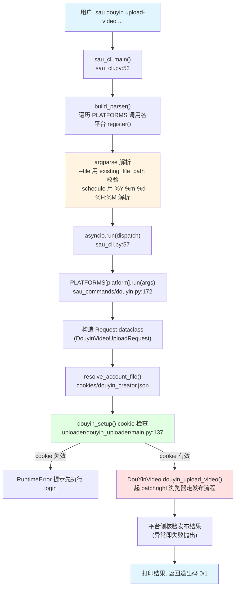
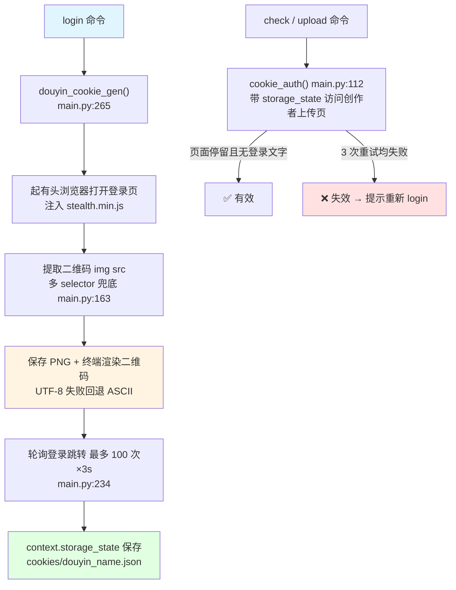
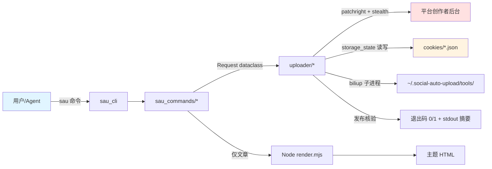

# social-auto-upload - 运行机制详解

> 生成时间: 2026-11-04
> 数据来源: 分析脚本输出 + 源码追踪（脚本原始数据见 `out/01~05-*.md`）

## 一、项目运行方式

项目主线是 **`sau` CLI + patchright 浏览器自动化**：每个命令对应一次"读 cookie → 起浏览器 → 自动化操作平台页面 → 核验发布结果"的完整异步流程。历史 Web 版（`sau_backend.py`）是 Flask + SSE 的服务化形态，当前非主线。

### 1. 安装与执行

```bash
# 安装（推荐 uv，见 docs/install.md）
uv tool install .
# 或: pip install -e .

# 首次配置
copy conf.example.py conf.py        # Windows
# 按需设置 LOCAL_CHROME_PATH（本机 Chrome 路径，可留空）

# 可选：Markdown 主题渲染需要 Node.js 22+
sau article setup

# 运行示例
sau douyin login --account creator       # 扫码登录，生成 cookie
sau douyin check --account creator       # 校验 cookie 有效性
sau douyin upload-video --account creator --file videos/demo.mp4 --title "标题" --desc "简介"

# 测试（unittest）
python -m unittest discover tests
```

### 2. CLI 总体执行流程



**错误处理约定**：`sau_cli.main()` 捕获所有异常，打印到 stderr 并返回 1（`sau_cli.py:58-60`）；发布"成功"不是点击发布按钮就算，而是 uploader 内部等到平台侧确认（如抖音等待发布记录出现）才返回。

## 二、核心运行机制

### 2.1 账号会话机制（cookie 生命周期）

**位置**: `sau_commands/arguments.py:16-19`、`uploader/douyin_uploader/main.py:112-147`

**说明**: 所有平台的账号状态都是 `cookies/{platform}_{account_name}.json` 一个文件（Playwright `storage_state` 格式）。一个 `account_name` 对应一个账号，多账号 = 多文件。



**机制作用**:

- **cookie 即会话**：无数据库、无服务端，账号状态完全本地文件化，天然支持多账号并发（不同 account 互不干扰）。
- **惰性刷新**：`douyin_setup(handle=False)` 只检查不登录，失效时报错引导用户 login；`handle=True` 时自动打开重新登录流程。
- **校验容错**：`cookie_auth` 重试 3 次，等待页面稳定 2.5s 防瞬时跳转误判（`main.py:126`）。
- **抖音短信二次验证**：触发时优先读项目根目录 `verify_code.txt`，交互终端则提示输入（`_read_verify_code`，`main.py:32-43`）——这让 Agent 可以写文件代替人敲验证码。

### 2.2 浏览器自动化与反检测机制

**位置**: `utils/base_social_media.py:21-24`、`uploader/douyin_uploader/main.py:50-89`

**说明**: 全部平台用 **patchright**（Playwright 的反检测补丁分支）驱动 chromium，每次 `new_context` 后注入 `utils/stealth.min.js` 隐藏自动化特征。

**关键细节**:

- **stealth 注入**：`await context.add_init_script(path=stealth_js_path)` 在每个页面加载前执行，覆盖 `navigator.webdriver` 等指纹。
- **真人级点击**：`_native_click()` 对目标元素执行"滚动入视图 → 真实鼠标移动到中心 → 点击 → JS 派发完整 pointer/mouse 事件序列"（`main.py:50-89`）。抖音身份验证组件只认这整套事件，普通 `locator.click()` 无效——这是对平台反自动化对抗的直接产物。
- **无头默认**：`--headless` 默认开启，`--headed` 可切换；登录二维码场景自动保存 PNG 并在终端渲染，无头也能扫码。
- **启动参数**：`--no-sandbox --disable-blink-features=AutomationControlled`（`main.py:117`）。

### 2.3 发布流程机制（以抖音视频为例）

**位置**: `uploader/douyin_uploader/main.py:628`（DouYinVideo）、`:1126`（DouYinNote）

**流程**（源码追踪归纳）:

1. `BaseVideoUploader.validate_video_file()` 校验扩展名（8 种视频格式白名单，`uploader/base_video.py:8-17`）；`validate_publish_date()` 强制定时时间 > 当前 +2 小时（平台规则，`base_video.py:66-68`）。
2. 打开 `creator.douyin.com/creator-micro/content/publish/video`，`set_input_files` 注入本地视频文件（大文件靠浏览器原生上传）。
3. 逐项填写：标题（`document.execCommand` 插入保留换行）、话题标签、封面（横/竖屏两套）、商品链接、合集、声明。
4. 定时发布：`publish_strategy = scheduled` 时设置平台定时器（`DOUYIN_PUBLISH_STRATEGY_*`，`main.py:24-25`）。
5. `_native_click` 点击发布，随后**轮询平台侧确认发布成功**（不依赖按钮点击结果），失败抛异常 → CLI 退出码 1。

**内容元数据约定**（全平台统一）：视频 `title+desc+tags`；图文 `title+note+tags`（note 可来自 `--notef` 文件）；文章 `title+content-file(+source/+theme)`。

### 2.4 Bilibili 外部二进制托管机制

**位置**: `uploader/bilibili_uploader/runtime.py`（191 行）

**说明**: Bilibili 是唯一不走浏览器自动化的主流平台——封装开源 `biliup` CLI 二进制，运行时自管下载与更新。

```mermaid
graph LR
    A["sau bilibili ..."] --> B["run_biliup_command()<br/>runtime.py:178"]
    B --> C["ensure_biliup_binary(force_check=False)<br/>本地存在则直接复用"]
    C -->|缺失/需要更新| D["GitHub API 查 latest release<br/>runtime.py:77"]
    D --> E["按 platform-machine 选资产<br/>windows-x86_64 → biliup.exe"]
    E --> F["下载 zip/tar.xz 到临时目录<br/>解压挑出可执行文件"]
    F --> G["原子替换 ~/.social-auto-upload/<br/>tools/biliup/&lt;key&gt;/biliup[.exe]<br/>非 Windows 补 chmod +x"]
    G --> H["subprocess.run 执行命令<br/>UTF-8 + errors=replace"]

    style A fill:#e1f5ff
    style C fill:#fff4e1
    style G fill:#e1ffe1
```



**机制作用**:

- **免安装**：用户无需预装 biliup，首次命令自动就位（README 承诺）。
- **弱网容错**：GitHub 限流/网络失败时若本地已有二进制则直接复用（`runtime.py:163-167`）；默认 `force_check=False` 避免每次请求 API。
- **跨平台资产矩阵**：`_select_release_asset` 覆盖 windows/linux/macos × x86_64/aarch64/arm（`runtime.py:53-61`）。

### 2.5 文章渲染机制（Node.js 子进程）

**位置**: `utils/article_render.py:26-59`、`utils/article_renderer/render.mjs`

**说明**: Markdown 主题渲染委托给本地 Node 子进程，Python 侧只做编排。

- 输入识别三类：`.md/.markdown`（必须渲染）、`.html/.htm`（直用）、`.txt`（逐行转 `<p>`）。
- Markdown 路径：检查 `node` 存在 + `node_modules/baoyu-md` 已安装，否则引导 `sau article setup`；然后 `subprocess.run([node, render.mjs])`，**正文通过 stdin 传 JSON**（`input=json.dumps(...)`），不进命令行参数——避免长文超参数长度限制和 shell 注入。
- 主题白名单 5 个：`plain/default/grace/simple/modern`（`article_render.py:14-20`）。
- `sau article setup` 用 `npm ci --ignore-scripts`（按锁文件安装、不跑安装脚本，`article_render.py:93`），Node 版本强制 ≥22。
- 依赖溯源：`utils/article_renderer/` 内含 BAOYU-LICENSE / DOOCS-LICENSE / NOTICE.md，第三方渲染器授权清晰。

### 2.6 Agent Skill 机制

**位置**: `skills/`（18 个目录）、`docs/skill-distribution.md`

**说明**: 每个平台一个 Skill 目录（`SKILL.md` + `references/` + `scripts/`），frontmatter 声明 `name/description/license: MIT-0`。SKILL.md 的核心指令是"**优先把 `sau` 当主接口，不要先读 `uploader/` 源码**"，`references/` 里放运行前提、CLI 契约、故障排查三层文档；`scripts/examples/` 提供同构的 `.sh` 和 `.ps1` 双平台调用示例。安装方式：`npx skills add dreammis/social-auto-upload --skill douyin-upload`。

### 2.7 历史遗留 Web 版机制（非主线）

**位置**: `sau_backend.py`（Flask，端口 5409）、`sau_frontend/`（Vue3 + Vite + Element Plus + Pinia）

**说明**: 形态为"Vue 前端 → Flask API → uploader"。特色机制：

- **SSE 扫码登录**：`/login` 接口用 `text/event-stream` 推流，后端起浏览器取二维码 base64 推给前端，扫码结果经 `queue` + `sse_stream()` 生成器回传（`sau_backend.py:713`）。
- **每请求独立事件循环**：Flask 同步视图里用 `asyncio.new_event_loop()` + `run_until_complete()` 桥接 async uploader（`sau_backend.py:689`），按 type 1/2/3/4 分发小红书/视频号/抖音/快手。
- SQLite 存账号与文件（`db/createTable.py`），`/upload` 上传视频返回唯一 id，`/postVideo` 组合发布。
- `docs/legacy-web.md` 明确：**历史保留、不承诺可运行、不与主线 uploader 同步**。新部署不建议使用。

## 三、运行时数据流总览



**退出码契约**：`check` 打印 `valid/invalid` 并返回 0/1；发布类命令成功打印 `... submitted` 返回 0；任何异常 → stderr + 退出码 1。Agent Skill 正是依赖这套契约做自动化判断。
